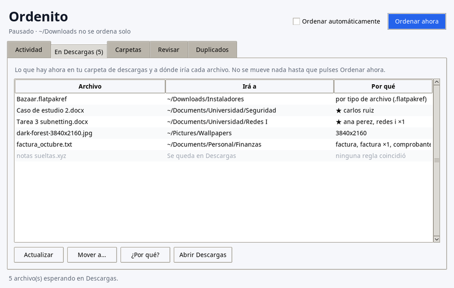
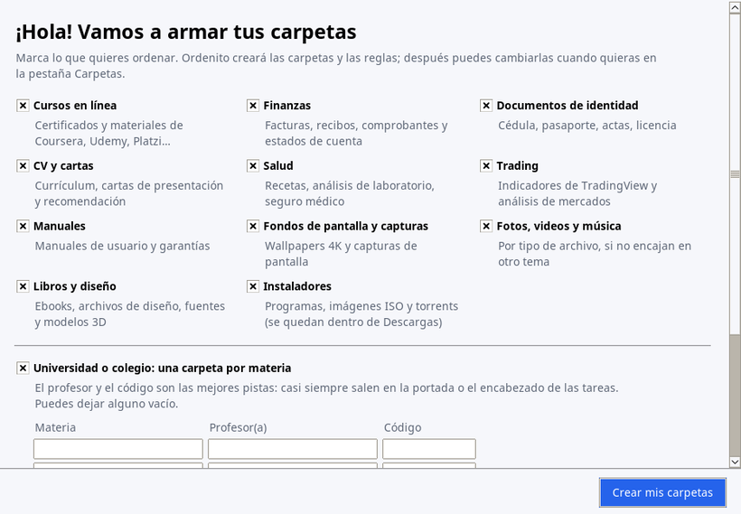
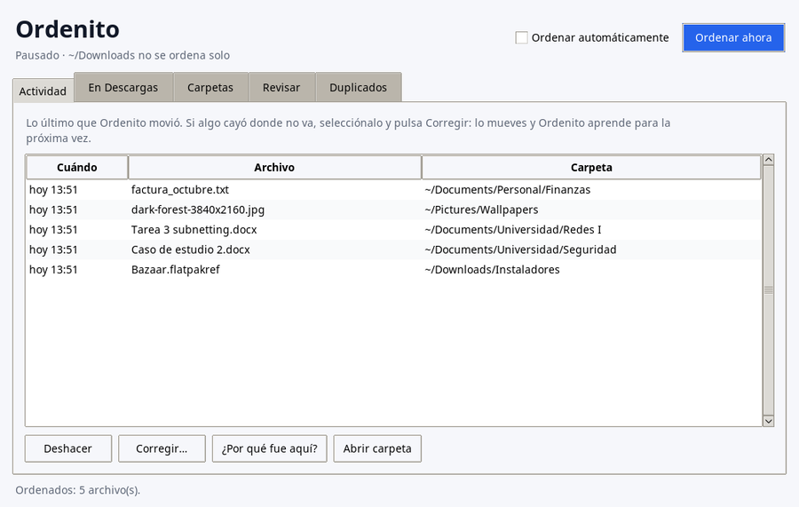
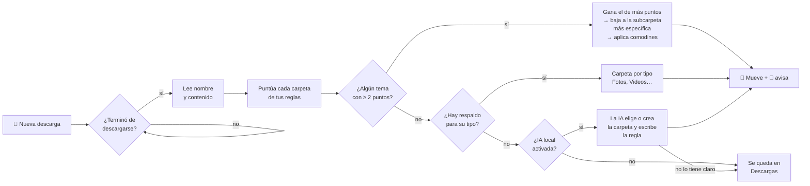

<div align="center">

# 🗂️ Ordenito

**Tus descargas se ordenan solas.**
Ordenito lee el nombre *y el contenido* de cada archivo que descargas y lo lleva a la carpeta que le corresponde, al instante.

[](https://github.com/Gr8coolmind/ordenito/actions/workflows/pruebas.yml)


[](LICENSE)

</div>

---

```text
📥 Descargas/
 ├─ Tarea3_subnetting.docx         ──▶  📁 Universidad/Redes
 ├─ informe-final-tienda.md        ──▶  📁 Universidad/Redes/Proyecto Final
 ├─ factura_octubre.pdf             ──▶  📁 Personal/Finanzas
 ├─ indicador_fvg.pine              ──▶  📁 Trading/Indicadores
 ├─ dark-forest-3840x2160.jpg       ──▶  🖼️ Pictures/Wallpapers
 └─ Bazaar.flatpakref               ──▶  📦 Descargas/Instaladores
```

La mayoría de los organizadores solo miran la extensión: todos los PDF juntos, todas las imágenes juntas. **Ordenito lee lo que dice el documento.** Una tarea que menciona a tu profesora y el código de la materia va a la carpeta de esa materia, aunque se llame `documento(3).docx`.

<p align="center"></p>

> 🪟 **¿Tienes Windows?** Mira [Instalación en Windows](#-en-windows): doble clic en `instalar.cmd` y listo.
>
> 🍎 **¿Tienes Mac?** Sigue el **[tutorial paso a paso para macOS](docs/macos.md)**: está pensado para alguien que nunca ha usado la Terminal.

## ✨ Qué lo hace distinto

| | |
|---|---|
| 🧠 **Lee el contenido** | Word, PowerPoint, Excel, LibreOffice, PDF, texto, código… y hasta los nombres de lo que trae un `.zip` (sin descomprimirlo). |
| ⚡ **Al instante** | Un servicio (systemd en Linux, launchd en Mac, un vigilante que arranca con tu sesión en Windows) vigila tu carpeta de descargas. Unos 2 segundos después de terminar una descarga, el archivo ya está en su lugar. |
| 🪪 **Reconoce al dueño del documento** | Lee el autor, el título, los encabezados y la portada. Si una tarea es *del* profesor de Seguridad, va a Seguridad, aunque hable mucho de redes. |
| 🪆 **Entiende subcarpetas** | Si un archivo encaja en `Universidad` y también en `Universidad/Redes`, va a la más específica. |
| 🃏 **Comodines** | `[*/Proyecto Final]` crea esa subcarpeta dentro de *cualquier* materia que gane. |
| 🖱️ **App con botones** | Una ventana para ver qué se movió, deshacer, corregir, revisar carpetas, quitar duplicados y editar tus carpetas, sin tocar archivos de texto. Funciona igual en Linux y Mac. |
| 🧭 **Carpetas recomendadas** | La primera vez, un asistente te pregunta qué quieres ordenar y cuáles son tus materias y profesores, y lo arma todo. |
| 🔍 **Te explica sus decisiones** | `ordenito explicar archivo.pdf` muestra los puntos de cada carpeta y las palabras que coincidieron. |
| 🎓 **Aprende de tus correcciones** | `ordenito corregir archivo carpeta` lo mueve a donde va y te ofrece aprender la pista que faltaba (el autor, el código de la materia, el docente). |
| 👯 **Sin duplicados** | Si descargas algo que ya tenías, no guarda una copia `(1)`: la manda a la papelera y te avisa. `ordenito duplicados` encuentra las copias que ya tienes. |
| ↩️ **Se puede deshacer** | `ordenito deshacer` devuelve el archivo, y Ordenito no lo vuelve a mover. |
| 🔒 **100 % local** | No usa internet ni IA en la nube (la IA opcional corre en tu equipo). Nada de tus documentos sale de tu computadora. |
| 📄 **Lee PDF sin instalar nada** | Trae su propio lector de PDF (también los que exporta Word). Si tienes `pdftotext`, lo usa. |
| 🖥️ **Más carpetas** | Además de Descargas, puede ordenar el Escritorio u otras carpetas de "entrada" (bloque `[vigilar]`). |
| 🤖 **IA local (opcional)** | Lo que ninguna regla reconoce lo decide un modelo que corre en tu equipo con [Ollama](https://ollama.com), gratis y sin internet. Elige una carpeta tuya o **crea una nueva**, y escribe la regla para que la próxima vez no haga falta preguntarle (bloque `[ia]`). |
| 🧹 **Limpieza de Descargas** | Opcional: manda a la papelera los instaladores, ISOs y torrents con más de N días (bloque `[limpieza]`). |
| 🌙 **Modo oscuro** | La app sigue el tema del sistema, o lo eliges en Ajustes. |
| 🪶 **Cero dependencias** | Solo Python y su biblioteca estándar (la app usa Tkinter, que viene con Python). |

## 🚀 Instalación

```bash
git clone https://github.com/Gr8coolmind/ordenito.git
cd ordenito
./instalar.sh
```

No necesita `sudo` y funciona igual en **Linux** y **macOS**. El instalador:
1. copia el comando a `~/.local/bin/ordenito`;
2. instala **la app**: "Ordenito" en tu menú de aplicaciones (Linux) u `Ordenito.app` en tu carpeta Aplicaciones (Mac);
3. crea tus reglas en `~/.config/ordenito/reglas.conf` (a partir del [ejemplo](reglas.ejemplo.conf)). Si prefieres, ábrelas en la app y usa el asistente;
4. activa el servicio que vigila tu carpeta de descargas (la detecta sola, aunque tu sistema esté en español).

**Para la app con ventana** hace falta Tkinter, que casi siempre viene con Python. Si el instalador avisa que no lo encontró:

| Sistema | Comando |
|---|---|
| Ubuntu / Debian / Mint | `sudo apt install python3-tk` |
| Fedora | `sudo dnf install python3-tkinter` |
| Arch / Manjaro | `sudo pacman -S tk` |
| Bazzite / Silverblue (inmutables) | `brew install python-tk` |
| macOS | `brew install python-tk` |

Después vuelve a ejecutar `./instalar.sh`. Sin Tkinter, el servicio automático y el comando `ordenito` funcionan igual.

> 💡 Para que lea los PDF instala `pdftotext`: `sudo dnf install poppler-utils` · `sudo apt install poppler-utils` · `sudo pacman -S poppler` · Mac: `brew install poppler`

### 🪟 En Windows

1. Instala Python 3.9 o más nuevo si no lo tienes: `winget install Python.Python.3.12` (o desde [python.org](https://www.python.org/downloads/)).
2. Descarga Ordenito (`git clone https://github.com/Gr8coolmind/ordenito.git` o **Code → Download ZIP**).
3. Doble clic en **`instalar.cmd`**.

No necesita administrador. El instalador copia Ordenito a `%LOCALAPPDATA%\Programs\Ordenito`, agrega el comando `ordenito` a tu terminal, pone **Ordenito** en el menú Inicio, crea tus reglas en `%APPDATA%\ordenito\reglas.conf` y enciende el vigilante (arranca solo al iniciar sesión, sin ventanas). Lo repetido va a la **Papelera de reciclaje** de verdad: se puede restaurar desde ahí o con `ordenito deshacer`.

Para quitarlo: `desinstalar.cmd` (con `/todo` borra también tus reglas e historial).

### 🍎 En Mac

Hay un paso extra: macOS no deja que un programa en segundo plano lea tus Descargas o Documentos sin permiso, así que hay que darle **Acceso total al disco** a Python (una sola vez). Todo está explicado con detalle en el **[tutorial para macOS](docs/macos.md)**: Homebrew, instalación, el permiso, la app, cómo ordenar lo que ya tienes y qué hacer si algo falla.

## 🖱️ La app

Ábrela desde tu menú de aplicaciones o con `ordenito-app`.

| Pestaña | Para qué sirve |
|---|---|
| **Actividad** | Lo último que se movió. **Deshacer**, **Corregir…** (lo mueves y Ordenito aprende), **¿Por qué fue aquí?** y **Abrir carpeta**. |
| **En Descargas** | Lo que hay en Descargas y a dónde iría cada archivo, con las pistas que lo deciden. **Mover a…** para enseñarle. |
| **Carpetas** | Tus carpetas y sus pistas, con formularios para crear, editar o quitar. Incluye **Carpetas recomendadas…** |
| **Revisar** | Elige una carpeta y te muestra qué archivos estarían mejor en otro lugar. Puedes moverlos con un clic. |
| **Duplicados** | Copias idénticas (compara el contenido, no el nombre). Las sobrantes van a la papelera. |

Arriba están **Ordenar automáticamente** (enciende o pausa el servicio) y **Ordenar ahora**.

<table>
<tr>
<td width="50%"><br><sub>La primera vez: carpetas recomendadas, materias y profesores.</sub></td>
<td width="50%"><br><sub>Actividad: deshacer, corregir y ver por qué.</sub></td>
</tr>
</table>

## 🧭 Cómo decide



- Una pista **fuerte** (profesor, código de materia, empresa, cliente) vale **25 puntos** si aparece en el nombre, el autor, el encabezado o la portada, y **3** si solo se menciona de pasada en el cuerpo.
- Cada palabra clave en el **nombre** del archivo vale **10 puntos**.
- Si el nombre se parece al de un archivo que **ya guardaste** en una carpeta (comparten dos palabras seguidas, como «Tienda Lunar»), esa carpeta suma **20 puntos**. Así la presentación de un caso va junto al documento del mismo caso. No cuentan números, tu nombre ni lo que esté en `[no sugerir]`, y si el parecido sale en varias carpetas no suma en ninguna.
- En el **contenido**, cada aparición vale **1 punto** (máximo 5 por palabra, así ninguna repetida gana sola).
- Las palabras se comparan **completas**, sin importar mayúsculas, tildes, guiones ni guiones bajos: `curso` no coincide dentro de `recurso`.

## 📝 Tus reglas

Las reglas se escriben en un archivo de texto muy simple, `~/.config/ordenito/reglas.conf`:

```ini
# [carpeta destino]   (relativa a tu HOME)
# palabras clave separadas por coma

[Documents/Universidad/Redes]
fuertes: red-1010, ana perez          # identidad: código y profesor
subnetting, vlan, cisco packet tracer # temas

# Comodín: dentro de cualquier materia, si menciona "proyecto final"
[*/Proyecto Final]
proyecto final, entrega final, capstone

# Solo para ciertos tipos de archivo
[Documents/Trading/Indicadores]
extensiones: pine, txt
@version=6, indicator(, strategy(

# Respaldo por tipo: solo extensiones, sin palabras
[Videos]
extensiones: mp4, mkv, webm

# Ordenar también estas carpetas, además de Descargas
[vigilar]
Desktop

# Instaladores con más de 30 días en Descargas → papelera (escribe 'apagada' para pausarla)
[limpieza]
dias: 30
extensiones: exe, msi, iso, torrent

# Lo que ninguna regla reconoce lo decide la IA local (ver «IA local»)
[ia]
modelo: qwen3:4b
```

**Consejos para buenas reglas**
- Las mejores pistas son **únicas**: el nombre del profesor, el código de la materia, el nombre del cliente o de la empresa. Ponlas en `fuertes:` y escríbelas como salen en los documentos.
- Evita palabras que salen en todo (tu carrera, tu universidad): no ayudan a distinguir.
- Si dos materias comparten prefijo (`MAT-101-01` y `MAT-101-02`), usa el código **completo**.
- Después de editar, comprueba con `ordenito explicar` y `ordenito revisar`.

El [archivo de ejemplo](reglas.ejemplo.conf) trae categorías listas para estudios, trabajo, trading, documentos personales, imágenes y respaldos por tipo.

## 🤖 IA local (opcional)

Las reglas son rápidas y nunca se equivocan con lo que ya conocen, pero un archivo de un tema nuevo se queda en Descargas. Con la IA local, ese archivo también encuentra su lugar:

1. Instala [Ollama](https://ollama.com) (gratis): `winget install Ollama.Ollama` en Windows, `brew install ollama` en Mac, o `curl -fsSL https://ollama.com/install.sh | sh` en Linux.
2. Descarga un modelo pequeño: `ollama pull qwen3:4b` (unos 2.5 GB; funciona en cualquier equipo con 8 GB de RAM, y más rápido con tarjeta gráfica).
3. Agrega a tus reglas:
   ```ini
   [ia]
   modelo: qwen3:4b
   ```

Desde ese momento, cuando ningún tema ni respaldo por tipo coincide, Ordenito le pasa a la IA el nombre del archivo, el inicio de su contenido y la lista de tus carpetas, y:

- si encaja en una carpeta que **ya tienes**, va ahí;
- si es de un tema nuevo, **crea la carpeta** dentro de `Documents` (por ejemplo `Documents/Universidad/Bases de Datos`), te avisa con una notificación y **escribe la regla** con las palabras clave del tema, marcada con `# la creó la IA`. El próximo archivo parecido lo ordena esa regla, sin preguntarle a la IA;
- si no lo tiene claro (una foto `IMG_2041.jpg` sin nada más), lo deja en Descargas.

Para que no se salga de lo suyo:
- Las reglas siempre van primero. La IA solo ve lo que ninguna regla reconoció.
- Solo crea carpetas dentro de `Documents` o de las carpetas que ya usan tus reglas, con 3 niveles como máximo. Nunca en Descargas, nunca fuera de tu carpeta personal ni con nombres que tu sistema no acepta. Si la carpeta ya existe escrita distinto (`redes` y `Redes`), usa la tuya.
- Nunca usa los nombres de `[no sugerir]` como carpeta ni como pista.
- Recuerda lo que respondió para cada archivo: no le pregunta dos veces lo mismo.
- `ordenito deshacer` devuelve el archivo y, si la carpeta que creó quedó vacía, la quita junto con su regla.
- Si Ollama está apagado, no pasa nada: el archivo espera en Descargas y se intenta con la próxima descarga.

Antes de responder, el modelo **razona** sobre el tema del archivo. Eso le lleva cerca de un minuto por archivo (en segundo plano, y solo con lo que tus reglas no reconocieron), pero acierta mucho más: en nuestras pruebas, 5 de 6 contra 3 de 6. Si prefieres respuestas en un par de segundos, escribe `rápida` dentro de `[ia]`.

Si un archivo no tiene texto y su nombre no dice nada (`IMG_2041.jpg`, `DSC0012.png`, `Screenshot…`), ni se le pregunta: se queda en Descargas o va a su respaldo por tipo.

Para pausarla, escribe `apagada` dentro de `[ia]`. Para usar otro modelo, cambia la línea `modelo:` (por ejemplo `gemma3:4b`, o `qwen3:1.7b` si tu equipo es más modesto).

## 🛠️ Comandos

| Comando | Qué hace |
|---|---|
| `ordenito` | Ordena ahora lo que haya en Descargas (es lo que ejecuta el servicio). |
| `ordenito simular` | Muestra lo que haría, sin mover nada. |
| `ordenito explicar ARCHIVO` | Explica a qué carpeta iría un archivo y por qué. |
| `ordenito revisar [CARPETA]` | Busca archivos que, según tus reglas, estarían mejor en otro lugar. Respeta las subcarpetas que creaste tú. No mueve nada. |
| `ordenito historial [N]` | Muestra los últimos movimientos. |
| `ordenito deshacer [N]` | Devuelve a su lugar los últimos N archivos movidos (también los que fueron a la papelera). |
| `ordenito corregir ARCHIVO CARPETA` | Mueve un archivo mal clasificado y aprende la pista que faltaba. `--todas` acepta todas las sugerencias y `--pista TEXTO` agrega una a mano. |
| `ordenito-app` | Abre la app con ventana. |
| `ordenito servicio [encender\|apagar]` | Enciende, pausa o muestra el servicio automático. |
| `ordenito limpiar [--simular] [--dias N]` | Manda a la papelera los instaladores viejos de Descargas (o solo muestra cuáles). |
| `ordenito duplicados [CARPETA]` | Lista archivos idénticos (compara el contenido, no el nombre). Con `--papelera` quita las copias y se queda con el nombre más limpio. |

```console
$ ordenito explicar Tarea3_redes.docx
Tarea3_redes.docx
      8 pts  Documents/Universidad/Redes
            red 1010 ×1, prof. ana perez ×1, subnetting ×1, vlan ×2, enrutamiento ×1, cisco packet tracer ×2
  ✓   1 pts  */Proyecto Final
            proyecto final ×1

  → ~/Documents/Universidad/Redes/Proyecto Final  (dentro del tema: proyecto final ×1)
```

### Cuando algo cae donde no va

```console
$ ordenito corregir "Caso de estudio 2.docx" ~/Documents/Universidad/Seguridad
  📁 Caso de estudio 2.docx  →  ~/Documents/Universidad/Seguridad

  Pistas que encontré en el archivo:
    1. Carlos Ruiz
    2. SEG-2040
  ¿Cuáles agrego a esa carpeta? (ej. 1,3 · Enter = ninguna): 1,2
  ✓ Aprendido para [Documents/Universidad/Seguridad]: Carlos Ruiz, SEG-2040
  ✓ La próxima vez un archivo así irá solo a ~/Documents/Universidad/Seguridad
```

Tu nombre y el de tus compañeros salen en todos tus trabajos, así que no sirven para distinguir. Ponlos en el bloque `[no sugerir]` y nunca se te ofrecerán como pistas.

## 🛡️ Seguridad y privacidad

- **Todo ocurre en tu equipo.** No hay red, telemetría ni servicios externos. La IA local (si la activas) también corre en tu equipo: Ordenito solo le habla a Ollama en `127.0.0.1`.
- **Nunca sobrescribe ni borra nada.** Si ya existe un `informe.pdf` distinto, guarda el nuevo como `informe (2).pdf`. Si es idéntico, la copia va a la **papelera** (no se borra) y se recupera con `ordenito deshacer`.
- **No toca descargas a medias.** Ignora `.part` y `.crdownload`, y espera a que el archivo deje de crecer.
- **Lee con límites.** Lee como máximo 2 MB por parte de cada documento y 5 páginas de cada PDF, así que una *zip bomb* no puede llenarte la memoria.
- **Corre con baja prioridad** (`Nice=10`, E/S en modo *idle*), sin `sudo` y solo dentro de tu usuario.
- Lleva un registro en `~/.local/state/ordenito/historial.jsonl`, que es lo que hace posible `deshacer`.

## 🧪 Pruebas

```bash
python3 -m unittest discover -s tests -v
```

Las pruebas cubren la app (con una pantalla virtual), la puntuación, los nombres parecidos a lo ya guardado, las pistas fuertes (autor, encabezado y menciones de pasada), `corregir`, los duplicados, las rutas con enlaces de Silverblue, las subcarpetas, los comodines, los zips, los respaldos por tipo, los nombres repetidos, `deshacer` y la protección contra zip bombs. Se ejecutan en GitHub Actions con Python 3.9 a 3.13 en Linux y en macOS, y en un Mac real se prueba de punta a punta: instalar, descargar un archivo, comprobar que se ordena solo y abrir `Ordenito.app`.

## 🗑️ Desinstalar

```bash
./desinstalar.sh          # quita el programa y el servicio; conserva tus reglas
./desinstalar.sh --todo   # también borra las reglas y el historial
```

Tus archivos se quedan donde Ordenito los dejó.

## ❓ Preguntas frecuentes

<details>
<summary><b>¿En qué sistemas funciona?</b></summary>

En **Windows 10 y 11**, en **macOS** (Intel y Apple Silicon) y en cualquier **Linux con systemd** (Fedora, Ubuntu, Debian, Arch, Bazzite, Silverblue…), con cualquier escritorio. En Linux, las notificaciones usan `notify-send`; en Mac, el centro de notificaciones. En cada cambio se prueba en Linux y en un Mac real, incluida la instalación con launchd.
</details>

<details>
<summary><b>Abrí la descarga desde el navegador y dice que no existe</b></summary>

Ordenito ya la movió. La notificación te dice a dónde, y también lo ves con `ordenito historial`.
</details>

<details>
<summary><b>¿Puedo vigilar otra carpeta?</b></summary>

Sí. Usa la variable `ORDENITO_CARPETA` (por ejemplo, `ORDENITO_CARPETA=~/Escritorio ordenito simular`). Para el servicio, edita `PathChanged=` en `~/.config/systemd/user/ordenito.path`.
</details>

<details>
<summary><b>Un archivo cayó en la carpeta equivocada</b></summary>

Usa `ordenito corregir ARCHIVO CARPETA_CORRECTA`. Lo mueve y te ofrece aprender la pista que faltaba. Si quieres entender qué pasó, `ordenito explicar ARCHIVO` muestra los puntos de cada carpeta.
</details>

---

<details>
<summary>🇬🇧 <b>English</b></summary>

**Ordenito** auto-sorts your Downloads folder on Linux and macOS, with a Tkinter desktop app (activity, undo, correct-and-learn, review, duplicates, rule editor and a recommended-folders wizard). Instead of sorting only by file extension, it reads each file's **name and content** (docx, pptx, xlsx, odt, pdf, text, code, and the file names inside zips) and scores it against simple keyword rules. A systemd path unit (Linux) or launchd agent (macOS) triggers it instantly whenever a download finishes. It supports nested folders (the most specific one wins), wildcard subfolders such as `[*/Final Project]`, per-extension rules, type-based fallbacks, `explain`/`review`/`history`/`undo` commands, and runs 100% locally with zero dependencies. Install with `./instalar.sh`. The CLI and docs are in Spanish.
</details>

<div align="center">
<sub>Hecho con ☕ por Gr8coolmind</sub>
</div>
