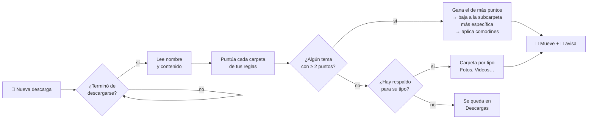

<div align="center">

# 🗂️ Ordenito

**Tus descargas se ordenan solas.**
Ordenito lee el nombre *y el contenido* de cada archivo que descargas y lo lleva a la carpeta que le corresponde, al instante.

[](https://github.com/Gr8coolmind/ordenito/actions/workflows/pruebas.yml)


[](LICENSE)

</div>

---

```text
📥 Descargas/
 ├─ Tarea3_subnetting.docx         ──▶  📁 Universidad/Redes
 ├─ informe-final-tienda.md        ──▶  📁 Universidad/Redes/Proyecto Final
 ├─ factura_octubre.pdf             ──▶  📁 Personal/Finanzas
 ├─ indicador_fvg.pine              ──▶  📁 Trading/Indicadores
 ├─ dark-forest-3840x2160.jpg       ──▶  🖼️ Pictures/Wallpapers
 └─ Bazaar.flatpakref               ──▶  📦 Descargas/Instaladores
```

La mayoría de los organizadores solo miran la extensión: todos los PDF juntos, todas las imágenes juntas. **Ordenito lee lo que dice el documento.** Una tarea que menciona a tu profesora y el código de la materia va a la carpeta de esa materia, aunque se llame `documento(3).docx`.

## ✨ Qué lo hace distinto

| | |
|---|---|
| 🧠 **Lee el contenido** | Word, PowerPoint, Excel, LibreOffice, PDF, texto, código… y hasta los nombres de lo que trae un `.zip` (sin descomprimirlo). |
| ⚡ **Al instante** | Un servicio de systemd vigila tu carpeta de descargas. Unos 2 segundos después de terminar una descarga, el archivo ya está en su lugar. |
| 🪆 **Entiende subcarpetas** | Si un archivo encaja en `Universidad` y también en `Universidad/Redes`, va a la más específica. |
| 🃏 **Comodines** | `[*/Proyecto Final]` crea esa subcarpeta dentro de *cualquier* materia que gane. |
| 🔍 **Te explica sus decisiones** | `ordenito explicar archivo.pdf` muestra los puntos de cada carpeta y las palabras que coincidieron. |
| ↩️ **Se puede deshacer** | `ordenito deshacer` devuelve el archivo, y Ordenito no lo vuelve a mover. |
| 🔒 **100 % local** | No usa internet ni IA en la nube. Nada de tus documentos sale de tu computadora. |
| 🪶 **Cero dependencias** | Un solo archivo de Python, solo con la biblioteca estándar. `pdftotext` es opcional. |

## 🚀 Instalación

```bash
git clone https://github.com/Gr8coolmind/ordenito.git
cd ordenito
./instalar.sh
```

No necesita `sudo`. El instalador:
1. copia el programa a `~/.local/bin/ordenito`;
2. crea tus reglas en `~/.config/ordenito/reglas.conf` (a partir del [ejemplo](reglas.ejemplo.conf));
3. activa el servicio que vigila tu carpeta de descargas (la detecta sola, aunque tu sistema esté en español).

> 💡 Para que lea los PDF instala `pdftotext`: `sudo dnf install poppler-utils` · `sudo apt install poppler-utils` · `sudo pacman -S poppler`

## 🧭 Cómo decide



- Cada palabra clave en el **nombre** del archivo vale **10 puntos**.
- En el **contenido**, cada aparición vale **1 punto** (máximo 5 por palabra, así ninguna repetida gana sola).
- Las palabras se comparan **completas**, sin importar mayúsculas, tildes, guiones ni guiones bajos: `curso` no coincide dentro de `recurso`.

## 📝 Tus reglas

Las reglas se escriben en un archivo de texto muy simple, `~/.config/ordenito/reglas.conf`:

```ini
# [carpeta destino]   (relativa a tu HOME)
# palabras clave separadas por coma

[Documents/Universidad/Redes]
red-1010, prof. ana perez, subnetting, vlan, cisco packet tracer

# Comodín: dentro de cualquier materia, si menciona "proyecto final"
[*/Proyecto Final]
proyecto final, entrega final, capstone

# Solo para ciertos tipos de archivo
[Documents/Trading/Indicadores]
extensiones: pine, txt
@version=6, indicator(, strategy(

# Respaldo por tipo: solo extensiones, sin palabras
[Videos]
extensiones: mp4, mkv, webm
```

**Consejos para buenas reglas**
- Las mejores pistas son **únicas**: el nombre del profesor, el código de la materia, el nombre del cliente o de la empresa.
- Evita palabras que salen en todo (tu carrera, tu universidad): no ayudan a distinguir.
- Si dos materias comparten prefijo (`MAT-101-01` y `MAT-101-02`), usa el código **completo**.
- Después de editar, comprueba con `ordenito explicar` y `ordenito revisar`.

El [archivo de ejemplo](reglas.ejemplo.conf) trae categorías listas para estudios, trabajo, trading, documentos personales, imágenes y respaldos por tipo.

## 🛠️ Comandos

| Comando | Qué hace |
|---|---|
| `ordenito` | Ordena ahora lo que haya en Descargas (es lo que ejecuta el servicio). |
| `ordenito simular` | Muestra lo que haría, sin mover nada. |
| `ordenito explicar ARCHIVO` | Explica a qué carpeta iría un archivo y por qué. |
| `ordenito revisar [CARPETA]` | Busca archivos que, según tus reglas, estarían mejor en otro lugar. Respeta las subcarpetas que creaste tú. No mueve nada. |
| `ordenito historial [N]` | Muestra los últimos movimientos. |
| `ordenito deshacer [N]` | Devuelve a Descargas los últimos N archivos movidos. |

```console
$ ordenito explicar Tarea3_redes.docx
Tarea3_redes.docx
      8 pts  Documents/Universidad/Redes
            red 1010 ×1, prof. ana perez ×1, subnetting ×1, vlan ×2, enrutamiento ×1, cisco packet tracer ×2
  ✓   1 pts  */Proyecto Final
            proyecto final ×1

  → ~/Documents/Universidad/Redes/Proyecto Final  (dentro del tema: proyecto final ×1)
```

## 🛡️ Seguridad y privacidad

- **Todo ocurre en tu equipo.** No hay red, telemetría ni servicios externos.
- **Nunca sobrescribe nada.** Si ya existe `informe.pdf` en el destino, guarda el nuevo como `informe (2).pdf`.
- **No toca descargas a medias.** Ignora `.part` y `.crdownload`, y espera a que el archivo deje de crecer.
- **Lee con límites.** Lee como máximo 2 MB por parte de cada documento y 5 páginas de cada PDF, así que una *zip bomb* no puede llenarte la memoria.
- **Corre con baja prioridad** (`Nice=10`, E/S en modo *idle*), sin `sudo` y solo dentro de tu usuario.
- Lleva un registro en `~/.local/state/ordenito/historial.jsonl`, que es lo que hace posible `deshacer`.

## 🧪 Pruebas

```bash
python3 -m unittest discover -s tests -v
```

Las pruebas cubren la puntuación, las subcarpetas, los comodines, los zips, los respaldos por tipo, los nombres repetidos, `deshacer` y la protección contra zip bombs. Se ejecutan en GitHub Actions con Python 3.9 a 3.13.

## 🗑️ Desinstalar

```bash
./desinstalar.sh          # quita el programa y el servicio; conserva tus reglas
./desinstalar.sh --todo   # también borra las reglas y el historial
```

Tus archivos se quedan donde Ordenito los dejó.

## ❓ Preguntas frecuentes

<details>
<summary><b>¿Funciona fuera de GNOME?</b></summary>

Sí. Solo necesita Linux con systemd (Fedora, Ubuntu, Debian, Arch, Bazzite, Silverblue…). Las notificaciones usan `notify-send`, y si no está, simplemente no avisa.
</details>

<details>
<summary><b>Abrí la descarga desde el navegador y dice que no existe</b></summary>

Ordenito ya la movió. La notificación te dice a dónde, y también lo ves con `ordenito historial`.
</details>

<details>
<summary><b>¿Puedo vigilar otra carpeta?</b></summary>

Sí. Usa la variable `ORDENITO_CARPETA` (por ejemplo, `ORDENITO_CARPETA=~/Escritorio ordenito simular`). Para el servicio, edita `PathChanged=` en `~/.config/systemd/user/ordenito.path`.
</details>

<details>
<summary><b>Un archivo cayó en la carpeta equivocada</b></summary>

Ejecuta `ordenito deshacer`, mira el motivo con `ordenito explicar ARCHIVO` y agrega a tus reglas una palabra clave más específica.
</details>

---

<details>
<summary>🇬🇧 <b>English</b></summary>

**Ordenito** auto-sorts your Downloads folder on Linux. Instead of sorting only by file extension, it reads each file's **name and content** (docx, pptx, xlsx, odt, pdf, text, code, and the file names inside zips) and scores it against simple keyword rules. A systemd path unit triggers it instantly whenever a download finishes. It supports nested folders (the most specific one wins), wildcard subfolders such as `[*/Final Project]`, per-extension rules, type-based fallbacks, `explain`/`review`/`history`/`undo` commands, and runs 100% locally with zero dependencies. Install with `./instalar.sh`. The CLI and docs are in Spanish.
</details>

<div align="center">
<sub>Hecho con ☕ por Gr8coolmind</sub>
</div>
